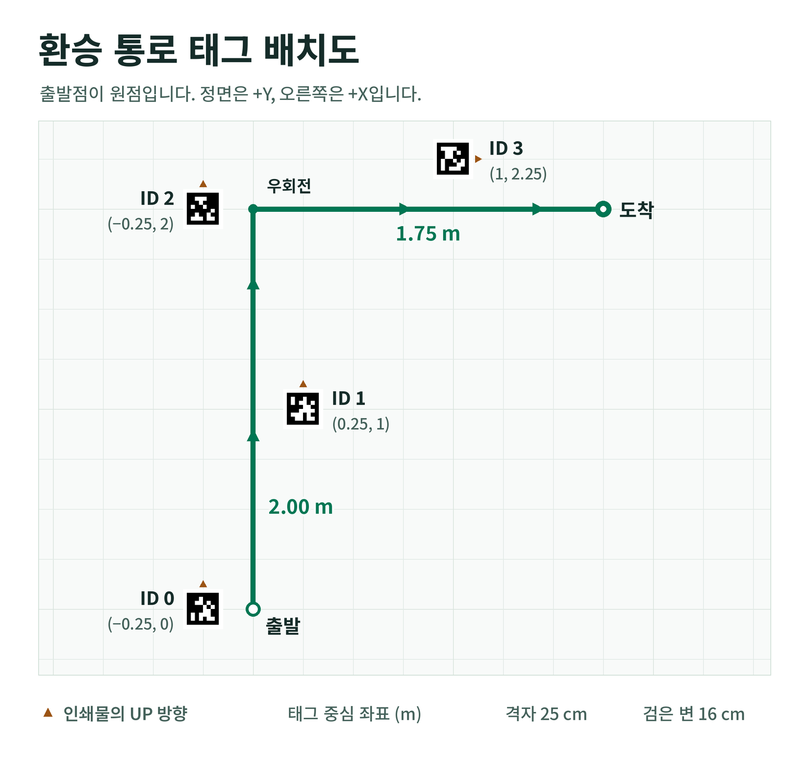

# 지하철 환승 통로 AR PoC

스마트폰에서 주소를 열고 브라우저의 카메라 권한을 허용하면 후면 영상이 바로 열린다. 등록된 AprilTag가 보이면 스마트폰의 위치를 통로 좌표계에서 추정하고, 진행할 방향을 바닥 화살표 하나로 표시한다. 위치 계산은 기기에서 수행한다. 하단의 **기록 시작**을 누르면 NestJS 서버에 시각이 일치하는 사진과 자세가 쌓이고, **기록 종료**를 누르면 서버가 3D 점군을 계산한다.

## 바닥에 놓을 것

준비물은 스마트폰, A4 출력물, 줄자, 종이를 평평하게 고정할 테이프다. 평평한 바닥에서 출발점과 코너를 정하면 된다. 기본 코스는 **직진 2.00 m 후 오른쪽으로 1.75 m**다.



1. [태그·보정판 PDF](experiments/corridor/field-kit.pdf)에서 1~4쪽을 A4 **실제 크기 100%**로 인쇄한다. 검은 정사각형의 한 변은 160 mm, 아래 검산선은 100 mm다. 흰 여백을 보존한다.
2. 바닥 출발점을 원점으로 잡는다. 출발할 때 정면을 +Y, 오른쪽을 +X로 두고 아래 위치에 **검은 정사각형의 중심**을 맞춘다. 종이의 ‘UP’ 쪽을 표의 방향으로 놓는다.
3. 바닥에 코너 (0, 2)와 도착점 (1.75, 2)를 표시한다. 다른 통로에 맞출 때는 실측한 태그 중심, 방향, 경로 꼭짓점을 [배치 파일](frontend/public/station.json)에 입력한다. 단위는 m이며 태그 회전은 +Y에서 시계 방향이다.

| 태그 ID | X (m) | Y (m) | 인쇄물 위쪽 |
| --- | ---: | ---: | --- |
| 0 | −0.25 | 0 | 정면 (+Y) |
| 1 | +0.25 | 1 | 정면 (+Y) |
| 2 | −0.25 | 2 | 정면 (+Y) |
| 3 | 1 | 2.25 | 오른쪽 (+X) |

A4 인쇄용 PNG는 300 dpi다. [태그 0](experiments/corridor/images/tag-0.png) · [태그 1](experiments/corridor/images/tag-1.png) · [태그 2](experiments/corridor/images/tag-2.png) · [태그 3](experiments/corridor/images/tag-3.png) · [보정판](experiments/corridor/images/calibration-board.png)

## 현장 기록과 3D 파일

1. iPad에서 신뢰된 HTTPS 주소를 열고 후면 카메라를 허용한다. PC 한 대에서는 `http://localhost:8080`으로 시험할 수 있다.
2. **기록 시작**을 누르고 태그와 주변 바닥을 함께 비추며 옆이나 앞으로 조금씩 이동한다. 같은 질감이 서로 다른 위치에서 두 번 이상 보여야 깊이를 구할 수 있다.
3. **기록 종료**를 누르면 남은 사진을 전송한다. 대응점이 충분하면 하단에 점 개수와 **3D 받기**가 나타난다. 전송 중인 사진은 브라우저의 IndexedDB에 두고 서버 응답을 받은 뒤 지운다. 연결이 끊기면 같은 브라우저에서 같은 사이트를 다시 열어 전송을 이어갈 수 있다. 다른 앱으로 전환해 웹 카메라가 중단되면 그 세션의 기록도 종료된다.

브라우저는 최대 초당 두 장, 긴 변 최대 960 px의 JPEG를 전송한다. 위치 계산에 사용한 원본 프레임을 저장해 화살표나 하단 조작부가 사진에 들어가지 않는다. 태그가 안 보이는 프레임도 사진과 시각을 저장하며 `pose`는 `null`이다. `mediaTimeS`는 영상의 프레임 시각이고 `capturedAtMs`는 브라우저가 관측한 프레임 표시 시각을 Unix 밀리초로 환산한 값이다.

서버는 `data/recordings/<세션 UUID>/` 아래에 다음 파일을 저장한다.

| 파일 | 내용 |
| --- | --- |
| `session.json` | 시작 시각, 실험 당시 태그 배치·경로·렌즈 보정 설정 |
| `frames/000000/image.jpg`, `frame.json` | 같은 프레임의 사진, 시각, 영상 크기, 초점거리·주점, 카메라 자세, 태그 ID, 재투영 오차 |
| `cameras.ply` | 위치를 구한 프레임들의 카메라 중심점 |
| `scene.ply` | 서로 다른 위치에서 관측한 특징점을 삼각측량한 컬러 점군. 대응점이 충분할 때 생성 |
| `reconstruction.json` | 복원 상태, 관측한 프레임 수, 생성한 점 수 |
| `lidar.ply` 또는 `lidar.usdz` | **스캔 첨부**로 받은 네이티브 LiDAR 앱의 원본 파일 |

사진에서 계산한 3D 좌표의 단위는 m다. 역 좌표계는 출발점 기준 오른쪽이 +X, 정면이 +Y, 위가 +Z다. `cameraToWorld`는 카메라 좌표(오른쪽·아래·렌즈 앞)를 역 좌표로 바꾸는 행 우선 4×4 행렬이며 렌즈 위치는 인덱스 3, 7, 11에 있다. `intrinsics`는 저장한 사진의 픽셀 단위 `[fx, fy, cx, cy]`다. 기본 화각 70°로 구한 깊이에는 기기별 오차가 있다.

iPad Safari에서 웹앱이 읽는 입력은 RGB 카메라다. 센서 깊이가 필요하면 LiDAR 탑재 iPad의 ARKit 스캔 앱에서 PLY 또는 USDZ를 내보내고, 웹 기록을 종료한 뒤 **스캔 첨부**에서 파일을 선택한다(최대 256 MiB). 첨부 파일은 스캔 앱의 좌표계로 보관하므로 두 점군을 겹쳐 비교하려면 공통 기준점을 이용해 정합해야 한다. [Apple ARKit의 LiDAR 깊이 수집 예제](https://developer.apple.com/documentation/arkit/displaying-a-point-cloud-using-scene-depth) · [웹 깊이 API 지원 현황](https://developer.mozilla.org/en-US/docs/Web/API/XRFrame/getDepthInformation#browser_compatibility)

## Docker Compose로 HTTPS 실행

`home.soohyuk.dev`가 가리키는 호스트에서 TCP 80과 443을 Docker에 할당하고 외부에서 접근할 수 있게 한다. 공유기 뒤에 있다면 두 포트를 호스트로 전달한다. 호스트의 Nginx 등에서 이미 포트를 사용 중이면 Compose를 시작하기 전에 두 포트를 비운다. [Caddy 자동 HTTPS](https://caddyserver.com/docs/automatic-https)

호스트에서 저장소 루트로 이동해 실행한다.

```bash
./scripts/compose-up.sh
```

Caddy가 `home.soohyuk.dev` 인증서를 발급하고 갱신하며 HTTP 요청을 HTTPS로 보낸다. 최초 발급은 컨테이너가 시작된 뒤 진행된다. `docker compose logs -f caddy`에서 확인하고 휴대폰으로 [https://home.soohyuk.dev](https://home.soohyuk.dev)를 연다. `docker compose down`으로 종료해도 인증서는 `caddy_data` 볼륨에 보관된다. [Caddy Docker 이미지](https://hub.docker.com/_/caddy)


기록은 호스트의 `./data/recordings`를 컨테이너의 `/data/recordings`에 읽기·쓰기 바인드 마운트한다. 컨테이너를 제거해도 이 폴더의 사진과 점군은 남는다. 저장 경로를 바꾸려면 `RECORDINGS_DIR=/절대/경로 ./scripts/compose-up.sh`로 실행한다. 래퍼가 폴더를 준비하고 현재 사용자의 UID/GID로 수집기를 실행한다. 백엔드 소스, 복원 코드, 태그 배치 파일도 호스트에서 읽기 전용으로 마운트한다. 백엔드 TypeScript 수정은 `docker compose restart collector`로 반영한다.

호스트에서 직접 확인할 때는 `http://localhost:8080`을 연다. `APP_PORT`는 이 로컬 HTTP 포트를 바꾼다.

## Compose 없이 실행

Bash와 Node.js 24.15 이상(npm 포함)이 있는 PC에서 저장소 루트의 스크립트를 실행한다. 첫 실행 시 의존성을 설치한다. 스크립트 하나가 Vite(0.0.0.0:8080)와 NestJS(127.0.0.1:8081)를 함께 시작하고 종료한다. 브라우저는 같은 주소의 `/api/recordings`를 사용한다.

```bash
./scripts/start.sh
```

저장 경로는 Compose와 같이 `data/recordings`이며 `RECORDINGS_DIR`로 바꿀 수 있다. API 포트는 `API_PORT`로 지정한다. PC에서는 `http://localhost:8080`을 연다. 같은 네트워크에서는 터미널의 `Network` 주소로 페이지에 접속할 수 있다. 포트를 바꾸려면 `APP_PORT=8090 ./scripts/start.sh`로 실행한다. 종료는 `Ctrl+C`다.

### 스마트폰에서 카메라 사용

모바일 브라우저는 일반 LAN IP의 HTTP 페이지에서 카메라 접근을 제한한다. Android에서는 USB 포트 전달로 휴대폰의 `localhost`에서 카메라를 쓸 수 있다. PC에 Android SDK Platform Tools를 설치하고, 휴대폰의 USB 디버깅을 켜고 PC 연결을 허용한 뒤 **두 번째 터미널**에서 실행한다. [보안 컨텍스트 명세](https://www.w3.org/TR/secure-contexts/#is-origin-trustworthy) · [Android ADB 포트 전달](https://android.googlesource.com/platform/packages/modules/adb/+/refs/heads/main/docs/user/adb.1.md#networking)

```bash
adb reverse tcp:8080 tcp:8080
```

휴대폰의 Chrome에서 `http://localhost:8080`을 열고 카메라를 허용한다. PC 서버 포트를 변경했다면 명령의 두 번째 포트를 그 값으로 바꾼다.

기본 후면 렌즈를 태그와 그 앞의 바닥이 함께 보이게 기울인다. 출발점에서 정면 화살표, 코너에 접근하면 오른쪽 화살표를 확인한다. 화살표를 그릴 바닥 위치가 화면 밖에 있거나 태그를 놓치면 영상만 보인다. 카메라 권한을 거부했다면 브라우저 사이트 설정에서 허용하고 화면을 한 번 누르거나 새로고침한다. [합성 시험 영상으로 캡처한 직진·우회전 AR 화면](experiments/corridor/images/ar-camera.png)

### npm 개발 명령

프런트엔드 개발 명령만 사용할 때는 별도 터미널에서 저장소 루트의 `./scripts/collector.sh`로 수집 서버를 띄운다. 개발 서버(`npm run dev`, 기본 5173)와 빌드 미리보기(`npm run build` 후 `npm run preview`, 기본 4173)도 `0.0.0.0`에서 수신한다.

```bash
cd frontend
npm ci
npm test
npm run dev
```

## 호스트 Nginx와 Certbot으로 HTTPS 실행

호스트 Nginx로 직접 배포하는 경우에는 이 절차를 사용한다. Compose의 Caddy와 호스트 Nginx 중 TCP 80과 443을 사용할 서비스를 하나 선택한다. `home.soohyuk.dev`의 원본 호스트에서 실행한다. Ubuntu와 같은 systemd 환경에서 Bash, Node.js 24.15 이상(npm 포함), Nginx, Certbot의 Nginx 플러그인, `sudo` 권한이 필요하다. Ubuntu에서는 다음과 같이 설치한다.

```bash
sudo apt update
sudo apt install nginx certbot python3-certbot-nginx
```

도메인이 이 호스트를 가리키고 외부에서 TCP 80과 443으로 접근할 수 있어야 한다. 공유기 뒤의 호스트라면 두 포트를 전달한다. Cloudflare 프록시를 사용하는 경우 `http://home.soohyuk.dev/.well-known/acme-challenge/...` 요청이 최초 발급과 갱신 때 원본의 80번 포트에 도달해야 한다. 강제 HTTPS 규칙이 발급을 막으면 해당 경로를 규칙에서 제외한다. 인증서를 설치한 뒤 Cloudflare TLS 설정에는 Full (strict)를 사용한다. [Let's Encrypt HTTP-01](https://letsencrypt.org/docs/challenge-types/#http-01-challenge) · [Cloudflare Full (strict)](https://developers.cloudflare.com/ssl/origin-configuration/ssl-modes/full-strict/)

```bash
./scripts/certbot-up.sh YOUR_CERTBOT_EMAIL
```

스크립트는 프런트엔드를 빌드해 `/var/www/2026-hackathon-2`에 배포하고, Nginx에 도메인을 등록한 다음 Certbot으로 인증서와 HTTPS 리다이렉트를 설정한다. 같은 명령으로 새 빌드를 배포할 수 있다. 호스트에 같은 도메인의 Nginx 설정이 이미 있다면 그 설정에 이 앱의 정적 파일 경로를 반영하고 Certbot을 적용한다.

이 호스트 방식에서는 별도 터미널이나 서비스로 `API_HOST=127.0.0.1 ./scripts/collector.sh`를 실행한다. Nginx는 `/api/` 요청을 루프백 8081번의 NestJS로 전달한다.

발급 후 휴대폰에서 `https://home.soohyuk.dev`를 열고 카메라를 허용한다. Ubuntu 패키지의 갱신 타이머와 이 인증서의 갱신 경로는 다음 명령으로 확인한다.

```bash
systemctl status certbot.timer
sudo certbot renew --cert-name 2026-hackathon-2-home.soohyuk.dev --dry-run
```

## 위치와 화살표 계산

- 워커가 OpenCV.js로 `tag36h11`의 ID와 네 꼭짓점을 검출한다. 지도에 등록된 태그의 3D 좌표로 PnP를 풀고 카메라 중심을 m 단위로 구한다. 여러 태그가 보이면 RANSAC 합의를 확인한다. 너무 작은 태그나 재투영 RMS가 2.5 px를 넘는 결과는 버린다. [OpenCV PnP](https://docs.opencv.org/4.12.0/d5/d1f/calib3d_solvePnP.html)
- 위치를 경로에 투영해 앞쪽에 있는 고정 화살표를 고른다. 기본 설정에서는 같은 평면에 놓인 태그로 바닥과 영상 사이의 호모그래피를 구해 화살표 꼭짓점을 그린다. 추적이 끊긴 프레임에서는 즉시 지우며, 새 결과가 멎어도 마지막 프레임 시각에서 350 ms 후 지운다. [OpenCV 평면 호모그래피](https://docs.opencv.org/4.12.0/d9/dab/tutorial_homography.html)
- 기본 대각 화각 70°는 기기 보정 전의 가정이므로 카메라 위치 수치와 화살표 선택 시점에는 기기별 오차가 있다. 브라우저가 저장한 실험 기록은 연결이 복구되면 전송을 이어간다.

## 현장 확인

1. 출발점 (0, 0)과 코너 (0, 2)에서 후면 렌즈를 바닥 표식 수직 위에 들고, 각각 세 번 멈춘다. 원격 브라우저 개발자도구에서 아래 코드를 실행해 태그 ID와 위치를 읽을 수 있다. 위치의 앞 두 성분을 줄자로 잰 X·Y와 비교한다.
2. 폰을 기울였을 때 화살표가 같은 바닥 지점을 가리키는지 확인한다. 알려진 태그를 모두 가렸다가 다시 비춰 화살표 소실과 재등장을 확인한다. 도착점에 서면 화살표가 사라진다.

```js
window.addEventListener('station-pose', ({ detail }) => console.log(detail));
```

검출 결과는 `positionM` (X, Y, 바닥 위 높이), `tagIds`, `reprojectionPx`, `frameTimeMs`를 담는다. 추적 소실 이벤트의 값은 `null`이다. 재투영 오차 단위는 px이며, 현장 수평 위치 오차는 바닥 표식과의 거리로 확인한다.

### 특정 스마트폰을 보정할 때

PDF 5쪽의 보정판을 평평하게 붙인다. 실험에 쓸 후면 **영상 스트림**에서 줌, 해상도 비율, 화면 방향을 고정하고 보정판이 전부 보이는 프레임 15장 이상을 저장한다. 중앙과 네 모서리에서 거리와 기울기를 바꾼다. 영상 프레임은 원격 개발자도구에서 `document.querySelector('video')`를 원래 `videoWidth × videoHeight` 크기로 캔버스에 복사해 얻을 수 있다.

```bash
uv run experiments/corridor/calibrate.py /path/to/frames/*.jpg
```

출력한 JSON을 배치 파일의 `camera.calibration`에 넣고 다시 빌드한다. 보정 후에는 위치와 화살표 모두 실측 초점거리, 주점, 왜곡 계수를 사용한다. 실험 영상과 보정 영상의 방향이나 종횡비가 달라지면 같은 조건으로 다시 보정한다. [OpenCV 카메라 보정](https://docs.opencv.org/4.12.0/d4/d94/tutorial_camera_calibration.html)
